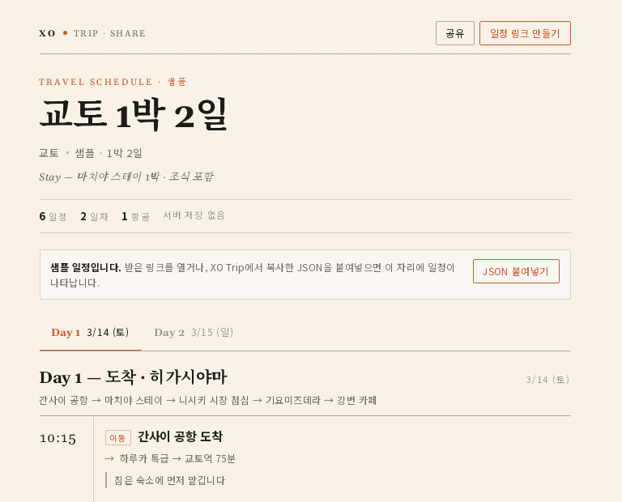

# XO Trip · 공유 뷰어

XO Trip에서 만든 여행 일정을 **링크 하나로** 건네는 웹 뷰어입니다.
`index.html` 한 파일로 동작하며, 빌드도 서버도 필요 없습니다.

- 공유 주소: <https://zzozzi-rgb.github.io/Xo-trip-share/>

<p align="center">
  
  
</p>

> 화면의 일정은 뷰어 동작을 보여 주는 가상 샘플(교토 1박 2일)이며 실제 개인 일정이 아닙니다.

## 무엇을 하나

1. XO Trip 앱에서 **여행 관리 → 현재 일정 JSON 복사**(또는 **여행 메이트 부분 공유**)로 JSON을 받습니다.
2. 이 페이지의 **[일정 링크 만들기]** 패널에 JSON을 붙여넣고 **[공유 링크 만들기]** 를 누릅니다.
3. 만들어진 `#d=…` 링크를 **[링크 복사]** 해서 카톡·문자·메일로 보냅니다.
4. 받은 사람은 앱 설치 없이 링크를 여는 것만으로 일정을 봅니다.

받은 사람은 각 일정 카드에 **👍 좋아요**와 **한 줄 메모**를 남길 수 있고,
**[내 의견 복사]** 로 정리된 문장을 복사해 다시 보낼 수 있습니다.

## 어떻게 동작하나

- 일정 JSON 전체를 `deflate-raw`(브라우저 `CompressionStream`)로 압축하고 base64url로 바꿔
  URL 해시(`#d=…`)에 담습니다. 압축을 지원하지 않는 브라우저에서는 평문 UTF-8 base64url(`#d=p…`)로 대체됩니다.
- 링크에 담기는 것은 화면이 그리는 부분(일정·일자·항공·예약)뿐입니다. 스팟·체크리스트·비용표·쇼핑 목록·바우처는
  링크에 들어가지 않아 링크가 짧고, 넘길 필요 없는 정보도 함께 나가지 않습니다.
- 해시(`#`)는 서버로 전송되지 않습니다. 링크를 여는 순간 **브라우저 안에서만** 압축을 풀어 화면을 그립니다.
  서버·DB·로그인·추적 스크립트가 없고, 외부 폰트나 CDN도 불러오지 않습니다.
- 좋아요와 메모는 `localStorage`에만 남습니다. 어디로도 전송되지 않습니다.

## 읽는 JSON

XO Trip의 여행 JSON 형식과 같습니다. 필수는 `title`과 `items`이고 나머지는 없으면 그냥 비워 둡니다.

```
title, place, dateRange, startDate, endDate, stay,
currency, currencySymbol, currencyUnit, krwPerUnit,
categories[] (key·label·glyph),
days[] (index·date·weekday·headline·summary),
items[] (id·day·time·cat·title·route·memo·cost·status·statusTone·
        mapQuery·durationMinutes·isFixedTime·together·lat·lon),
tickets[] (type=flight·booking·internet 등 / title·subtitle·code·note·url·phone),
reservations[] (title·badge·tone·code·lines[]·phone)
```

- `items[].cost`가 0이거나 없으면 금액을 표시하지 않습니다.
- `lat`·`lon`이 있으면 그 좌표로, 없으면 `mapQuery`로 구글맵을 엽니다.
- 여행 메이트 부분 공유 JSON처럼 `items`가 일부만 담긴 문서도 그대로 열립니다.

## 열지 않을 때

주소에 `#d=…`가 없으면 **가상의 샘플 일정**(교토 1박 2일, 실제 개인 일정 아님)이 보입니다.
샘플은 뷰어의 동작을 보여 주기 위한 것이며 실제 여행 정보는 담겨 있지 않습니다.

## 로컬에서 열기

`index.html`을 브라우저로 열면 됩니다. `file://`로 열었을 때 만들어진 링크는
GitHub Pages 주소를 기준으로 생성됩니다.

## 디자인

STUDIO XO의 지면 톤을 그대로 따릅니다 — 오프화이트 종이(`#F9F2E6`), 잉크 블랙(`#1C1B18`),
테라코타 포인트(`#C85A32`), 1px 헤어라인, 세리프 제목과 숫자 정렬(tabular figures).
일자는 탭으로, 하루의 흐름은 시간 축 카드로 읽힙니다.
