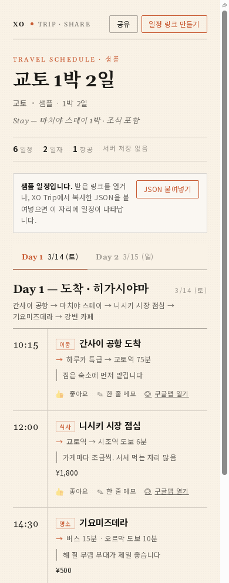

# XO Trip · 공유 뷰어

XO Trip에서 만든 여행 일정을 **링크 하나로** 건네는 웹 뷰어입니다.
`index.html` 한 파일로 동작하며, 빌드도 서버도 필요 없습니다.

- 공유 주소: <https://zzozzi-rgb.github.io/Xo-trip-share/>

<p align="center">
  
  
</p>

> 화면의 일정은 뷰어 동작을 보여 주는 가상 샘플(교토 1박 2일)이며 실제 개인 일정이 아닙니다.

## 무엇을 하나

1. XO Trip 앱에서 **여행 관리 → 현재 일정 JSON 복사**(또는 **여행 메이트 부분 공유**)로 JSON을 받습니다.
2. 오른쪽 위 **+** 버튼을 눌러 **XO Trip JSON** 칸에 그대로 붙여넣고 **[짧은 링크 만들기]** 를 누릅니다.
   - **짧은 링크(`?id=xxxxxxxx`)**: 일정을 Supabase에 저장하고 8자리 주소를 만듭니다. 카톡·문자에 붙이기 좋습니다.
   - **긴 링크(`#d=…`)**: 아래 **[긴 링크(#d=)로 만들기]**. 일정 전체가 주소 안에 압축되어 들어가고 서버를 거치지 않습니다(주소가 길어질 수 있음).
3. 만들어진 링크를 **[복사]** 해서 카톡·문자·메일로 보냅니다.
4. 받은 사람은 앱 설치 없이 링크를 열고 **Day 칩**으로 날짜를 넘기며 일정을 봅니다. 카드의 **👍** 와 **말풍선**으로 좋아요·한 줄 메모를 남기고, **[지도]** 로 구글맵을 엽니다.

받은 사람이 남긴 좋아요·메모는 링크를 함께 보는 사람의 카드에 **이름과 함께** 모이고, 20초마다 새로 불러옵니다.

## 좋아요와 메모는 어디로 가나

- 위쪽 **내 이름** 칸(기본 `동행자`, 이 브라우저에 기억)에 적은 이름으로 남깁니다.
- **짧은 링크(`?id=`)나 여행 `id`가 있는 링크**에서: 좋아요·메모가 Supabase `trip_reactions` 테이블에 즉시 저장되고,
  20초마다(그리고 다른 탭을 보고 돌아올 때) 새로 불러와 함께 보는 사람의 반응이 카드에 나타납니다.
- 서버에 닿지 않을 때는 이 브라우저(`localStorage`)에만 남고, 화면 아래 **[내 의견 복사]** 로 문장을 만들어 보낼 수 있습니다.
- 샘플 일정에서는 서버로 아무것도 보내지 않습니다.

## 어떻게 동작하나

- **`#d=` 링크**: 일정 JSON 전체를 `deflate-raw`(브라우저 `CompressionStream`)로 압축하고 base64url로 바꿔
  URL 해시(`#d=…`)에 담습니다. 압축을 지원하지 않는 브라우저에서는 평문 UTF-8 base64url(`#d=p…`)로 대체됩니다.
  해시(`#`)는 서버로 전송되지 않으므로 이 링크는 서버·DB 없이 열립니다.
- **`?id=` 짧은 링크**: 8자리 랜덤 ID(혼동하기 쉬운 글자 제외)를 만들어 `shared_trips` 테이블에 일정을 저장하고
  `https://zzozzi-rgb.github.io/Xo-trip-share/?id=<id>` 를 만듭니다. 페이지를 열면 `shared_trips`에서 일정을 읽어 그립니다.
  저장에 실패하면 자동으로 `#d=` 링크로 대체합니다.
- 링크에 담기는 것은 화면이 그리는 부분(일정·일자·항공·예약)뿐입니다. 스팟·체크리스트·비용표·쇼핑 목록·바우처는
  링크에 들어가지 않아 링크가 짧고, 넘길 필요 없는 정보도 함께 나가지 않습니다.
- 동행자 반응은 Supabase `trip_reactions`(trip_id·item_id·author·liked·memo)에 쌓이고, 읽을 때는 `created_at` 순서로 가져옵니다.
  테이블 권한은 **넣기(INSERT)만** 열려 있어서, 고치거나 거둘 때도 새 행을 덧붙입니다(좋아요를 끄면 `liked:false`,
  메모를 지우면 빈 메모). 화면은 사람(작성자)마다 가장 최근 행을 그 사람의 현재 반응으로 보여 줍니다.
- 연결 정보(공개용 publishable key, RLS 적용)는 `index.html` 안에 있습니다. 서버 코드나 빌드 단계는 없습니다.

## 읽는 JSON

XO Trip의 여행 JSON 형식과 같습니다. 필수는 `title`과 `items`이고 나머지는 없으면 그냥 비워 둡니다.

```
title, place, dateRange, startDate, endDate, stay,
currency, currencySymbol, currencyUnit, krwPerUnit,
categories[] (key·label·glyph),
days[] (index·date·weekday·headline·summary),
items[] (id·day·time·cat·title·route·memo·cost·status·statusTone·
        mapQuery·durationMinutes·isFixedTime·together·lat·lon),
tickets[] (type=flight·booking·internet 등 / title·subtitle·code·note·url·phone),
reservations[] (title·badge·tone·code·lines[]·phone)
```

- `items[].cost`가 0이거나 없으면 금액을 표시하지 않습니다.
- `lat`·`lon`이 있으면 그 좌표로, 없으면 `mapQuery`로 구글맵을 엽니다.
- 여행 메이트 부분 공유 JSON처럼 `items`가 일부만 담긴 문서도 그대로 열립니다.

## 열지 않을 때

주소에 `?id=`도 `#d=…`도 없으면 **가상의 샘플 일정**(교토 1박 2일, 실제 개인 일정 아님)이 보입니다.
샘플은 뷰어의 동작을 보여 주기 위한 것이며 실제 여행 정보는 담겨 있지 않습니다.
`?id=` 링크의 일정을 찾지 못하면 오류를 알리고 샘플로 돌아갑니다.

## 배포

이 저장소의 GitHub Pages는 **`gh-pages` 브랜치**를 배포 소스로 쓰고 있습니다(설정 화면에서 `main`으로
바꿀 수 있습니다). `main`만 고치면 사이트는 그대로이므로, 고친 뒤에는 두 브랜치를 같게 맞춰 주세요.

```bash
git push origin main
git push -f origin main:gh-pages
```

Pages 소스를 `main`(root)으로 한 번 바꿔 두면 위 두 번째 줄은 필요 없어지고 `gh-pages`도 지워도 됩니다:
<https://github.com/zzozzi-rgb/Xo-trip-share/settings/pages>

## 로컬에서 열기

`index.html`을 브라우저로 열면 됩니다. `file://`로 열었을 때 만들어진 링크는
GitHub Pages 주소를 기준으로 생성됩니다.

## 디자인

STUDIO XO의 지면 톤(오프화이트 종이 `#F8F3EA`, 잉크 블랙 `#1B1A17`, 테라코타 포인트 `#C0562F`)은 그대로 두고,
읽는 글에서 **한눈에 누르는 화면**으로 바꿨습니다.

- 상단 히어로: 장소·제목·기간·숙소, `Day 1~4` 가로 칩(모바일에서 스크롤해도 상단에 고정), 작은 `나` 이름 필.
- 일정 카드: 시간 축 + 카테고리 색 점, 카테고리 아이콘 태그, 장소명 1~2줄, 경로 1줄. 긴 메모는 1줄로 접고 눌러서 펼칩니다.
- 반응: `👍` 개수 토글 필 + 말풍선 메모 필, 오른쪽 끝에 지도 핀 버튼. 동행자 메모는 이름·첫 글자 아바타로 카드 아래에 모입니다.
- 안내 문장은 화면에서 걷어내고 아이콘·여백·상태 색으로 대신합니다.
- 390px 모바일과 데스크톱(좌측 고정 히어로 + 우측 일정) 두 열 모두에서 여백과 정렬이 유지됩니다.
